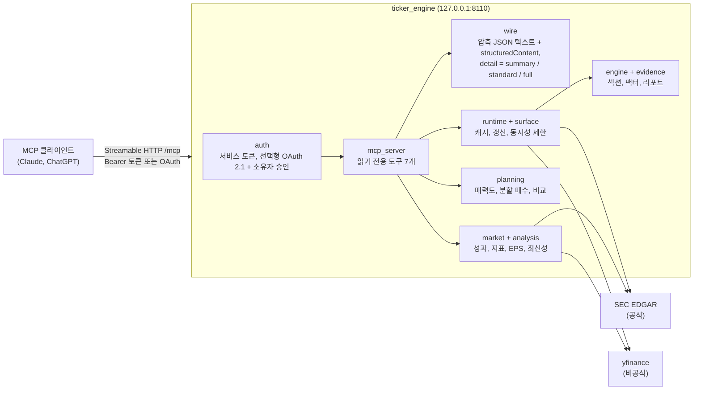

# Ticker Research

[English](README.md)

Ticker Research는 Claude, ChatGPT 같은 AI 채팅 클라이언트에서 종목 하나를 조사할 때 쓰는 읽기 전용
[MCP](https://modelcontextprotocol.io) 서버예요. 공시, 일봉 가격 이력, 계산 과정이 보이는 몇 가지 지표를 대화
안에서 보고 싶은 개인 투자자를 위해 만들었어요. 모든 숫자에는 출처와 기준 시점이 붙어요.

미국 종목은 전체 기능을 지원해요. 국내 상장 종목(예: `005930`)은 가격, 지표, 분할 매수 시나리오만 지원해요.
데이터 출처는 무료 두 가지예요.

- **SEC EDGAR**(공식): companyfacts 재무 데이터, Form 4 내부자 거래 공시, 10-K 희석 EPS. SEC는 연락처가 들어간
  `User-Agent`를 요구하므로 `SEC_USER_AGENT`에 설정해요.
- **[yfinance](https://github.com/ranaroussi/yfinance)를 통한 Yahoo Finance**(비공식): 일봉, 최근 체결가, 주요
  지표, 애널리스트 EPS 컨센서스. yfinance는 Yahoo의 공식 API가 아니어서 동작이 바뀌거나 요청이 제한될 수
  있어요. 여기서 온 값에는 결과마다 `yfinance` / "unofficial" 표시가 붙어요.

증권사 연결, 사이트 로그인, 계좌 데이터는 전혀 없어요.

## 도구

| 도구 | 반환 내용 |
|---|---|
| `get_ticker_research` | 미국 종목 하나의 스냅샷이에요. SEC 재무·내부자 공시, yfinance 지표와 일봉, 일봉으로 계산한 약 40개 팩터(RSI, MACD, ATR, 이동평균, 지지·저항 레벨, 낙폭, 위험 점수)를 담아요. 섹션마다 `as_of`, `as_of_basis`, `source`가 있어요. |
| `get_ticker_research_status` | 설정 상태를 보여줘요. SEC User-Agent 설정 여부, 기술 팩터 사용 여부, 인증 방식, 최근가 출처 상태가 들어 있어요. |
| `plan_entry` | 입력한 금액에 대한 분할 매수 계산이에요. 매력도 점수와 구성 요소, 계산된 레벨에서 정한 분할 가격, 도달 확률을 줘요. 계산일 뿐이고 주문이 아니에요. |
| `compare_tickers` | 같은 입력으로 2개 이상 종목의 순위를 매기고, 총액을 주면 배분 시나리오도 계산해요. |
| `compare_price_performance` | 미국·한국 주식, ETF, 지수 1–8개의 일간 가격 성과를 하나의 공통 거래일 달력으로 비교해요. 지표는 기준일 100 환산, 수익률(%), 벤치마크 대비 상대강도, 초과수익 중에서 골라요. USD와 KRW 사이 환산도 할 수 있어요. |
| `get_technical_indicators` | 종목 하나의 RSI, MACD, 볼린저 밴드, SMA/EMA/RMA, ATR 등을 계산해요. 워밍업 구간은 조회 기간 앞에서 따로 받아와요. |
| `get_eps_scenarios` | 회계연도별 GAAP 희석 EPS(SEC 10-K), 각 회계연도 말 P/E, 컨센서스 EPS 저/평균/고(yfinance)를 보여줘요. 약세/기본/강세 가격은 EPS × P/E 배수로 계산해요. 미국 SEC 공시 기업만 지원해요. |

없는 데이터는 0이 아니라 `unavailable`과 사유 코드로 표시해요. 출처가 설정되지 않은 섹션(예:
`SEC_USER_AGENT` 없이 SEC 조회)은 `provider_not_configured`로 나와요. 기본적으로는 최근 체결가(프리마켓
포함)가 잠정값으로 표시돼요. `confirmed_only=true`를 주면 모든 가격 도구가 확정 종가만 써요.

## 구조



HTTP 요청은 `ticker_engine/providers/`의 어댑터만 보낼 수 있어요. 이 규칙은
`tests/ticker_engine/test_isolation.py`가 검사해요. 엔진과 planning 코드는 외부 호출 없이 어댑터가 정규화한
행만 다뤄요. `full` 상세 수준에서는 계산값마다 입력, 공식 ID, 출처가 그대로 남아요.

## 응답 크기 예산

모든 도구는 `structuredContent`와, 같은 객체를 압축 JSON으로 담은 텍스트 블록을 함께 반환해요(MCP
2025-06-18). 그래서 텍스트만 모델에 넘기는 클라이언트도 `structuredContent`를 읽는 클라이언트와 같은 필드를
받아요.

| 도구 | 예산 |
|---|---|
| `get_ticker_research`, `plan_entry`, `compare_tickers` | 기본값 `detail=standard`는 최근 일봉 20개, 최근 4개 분기, 그 밖의 목록은 3행만 남겨요. 숫자는 반올림하고 출처는 섹션마다 한 번만 적어요. `summary`는 핵심 값만, `full`은 모든 필드를 담아서 이력 길이에 따라 커져요(아래 표 참고). |
| `compare_price_performance`, `get_technical_indicators`, `get_eps_scenarios` | `structuredContent` 92,000바이트 이하, 전체 응답 100 KB 미만, 요약 문장 2,000자 미만이에요. 시계열당 260포인트가 넘으면 주간 포인트로 바꿔요. 그래도 넘으면 몰래 자르지 않고 `RESPONSE_TOO_LARGE`를 반환해요. |

오프라인 테스트 픽스처(일봉 1년치)로 텍스트 블록 크기를 재면 다음과 같아요.

| 도구 | summary | standard | full |
|---|---:|---:|---:|
| `get_ticker_research` | 7.8 KB | 11.5 KB | 2.08 MB |
| `plan_entry` | 3.4 KB | 6.3 KB | 66.6 KB |
| `compare_tickers`(2종목) | 5.1 KB | 6.1 KB | 181 KB |

`full`에는 일봉마다 출처 정보와 마크다운 리포트가 들어 있어서 디버깅이나 내보내기 용도로만 쓰는 게 좋아요.

## 클라이언트 간 회귀 검증

같은 서버를 Claude(claude.ai는 모델에 `content[].text`만 보여줘요)와 ChatGPT(`structuredContent`를 읽어요)에서
함께 써요. 테스트는 네트워크 없이 실제 FastMCP 디스패처를 거쳐 두 경로를 모두 확인해요.

- `test_wire_mcp.py`는 세 dict 도구의 텍스트 블록이 상세 수준마다 `structuredContent`와 같은 JSON인지
  확인해요. 호출 전체가 실패하면 `isError:true`이고 부분 결과는 그렇지 않다는 점도 확인해요.
- `test_market_mcp.py`, `test_market_tools.py`, `test_market_eps.py`는 분석 도구의 요약에 핵심 숫자, 출처 줄,
  EPS의 약세/기본/강세 행이 들어 있는지 확인해요. 텍스트만 쓰는 클라이언트는 이 내용에 기대요. 위의 크기
  제한도 함께 확인해요.
- `test_freshness.py`는 모든 가격 도구가 확정 종가와 잠정 최근가를 똑같이 다루는지 확인해요.

이 프로젝트는 여러 클라이언트에서 실제로 채점한 회귀 실행 기록이 없어서 통과/부분/실패 수치는 없어요.
같은 방식의 수치는 함께 쓰는 프로젝트인 [K-invest](https://github.com/ianlyoo/K-invest)에서 공개하고 있어요.

## 읽기 전용 안전성

- 모든 도구에 `readOnlyHint: true, destructiveHint: false`가 붙어 있어요. 주문, 이체, 계좌 도구는 없고 증권사
  인증 정보도 읽지 않아요.
- 서버가 쓰는 상태는 메모리 캐시와, OAuth를 켰을 때의 OAuth 클라이언트·권한 저장소(`TICKER_RESEARCH_OAUTH_STATE_DIR`의
  SQLite)뿐이에요. 그 밖의 쓰기는 사용자가 직접 관리 명령(`python -m ticker_engine.auth.oauth_admin`, root
  전용)을 실행할 때만 일어나요.
- 서비스 토큰은 파일에서 읽은 뒤 SHA-256 다이제스트로만 보관하고, 로그나 응답에 절대 남기지 않아요.
- 요청은 `127.0.0.1`에서 직접 연결된 경우에만 받아요. 프록시 헤더가 붙은 요청은 원격으로 보고 OAuth를 요구해요.
- `plan_entry`와 `compare_tickers`의 결과는 공개 데이터로 계산한 시나리오이고 투자 조언이 아니에요.

## 빠른 시작

Python 3.11 이상이 필요해요.

```bash
git clone <this repository> ticker-research && cd ticker-research
python -m venv .venv && . .venv/bin/activate
pip install -e '.[dev]'
pytest tests/ -q                      # 오프라인, 네트워크와 인증 정보 불필요

# 서비스 토큰(A-Z a-z 0-9 _ - 로 된 32-256자), 파일 권한 0600
mkdir -p ~/.config/ticker-research/credentials && chmod 700 ~/.config/ticker-research/credentials
python -c 'import secrets; print(secrets.token_urlsafe(32))' > ~/.config/ticker-research/credentials/ticker-service-token
chmod 600 ~/.config/ticker-research/credentials/ticker-service-token

export CREDENTIALS_DIRECTORY=~/.config/ticker-research/credentials
export SEC_USER_AGENT="Your Name your.address@your-domain.tld"   # SEC 공정 접근 정책, 예시용 도메인은 거부돼요
ticker-research                       # http://127.0.0.1:8110/mcp
```

Streamable HTTP를 지원하는 MCP 클라이언트에서 `http://127.0.0.1:8110/mcp`를 등록하고
`Authorization: Bearer <ticker-service-token 파일 내용>` 헤더를 넣으세요. 그다음
`get_ticker_research_status`로 설정을 확인하면 돼요.

선택 설정이에요.

| 변수 | 효과 |
|---|---|
| `TICKER_TECHNICAL_ENABLED` | `true`(기본) 또는 `false`예요. 일봉 기반 팩터를 끌 수 있어요. |
| `TICKER_RESEARCH_PUBLIC_URL`, `TICKER_RESEARCH_OAUTH_REDIRECT_URIS`, `TICKER_RESEARCH_OAUTH_STATE_DIR`, `OWNER_GATE_REDIRECT_ORIGINS` | 동적 클라이언트 등록과 소유자 암호 승인 화면이 있는 OAuth 2.1을 켜요. 호스팅형 클라이언트용으로 직접 운영하는 HTTPS 리버스 프록시 뒤에 둘 때 써요. 암호 해시는 `python -m ticker_engine.auth.owner_gate hash`로 만들고 `CREDENTIALS_DIRECTORY`에서 읽어요. 인증 정보 파일 이름은 `ticker_engine/auth/`를 참고하세요. |

## 디렉터리 구성

```
ticker_engine/
  mcp_server.py   도구 정의와 ASGI 앱
  wire.py         압축 JSON 텍스트 블록과 상세 수준
  runtime.py      데이터 출처 조합, 캐시, 갱신
  engine.py       스냅샷 섹션과 팩터 계산
  evidence/       팩터 정의와 파생 위험 점수
  planning/       매력도, 분할 매수, 비교(planning/README.md 참고)
  market/         성과, 지표, EPS 시나리오, 최신성
  analysis/       지표 계산, TA-Lib 기준값과 대조
  providers/      SEC EDGAR, yfinance 어댑터
  auth/           서비스 토큰, OAuth 2.1, 소유자 승인
tests/            오프라인 테스트와 합성·공개 데이터 픽스처
```

## 라이선스와 지원

MIT 라이선스예요. [LICENSE](LICENSE)를 보세요.

개인 프로젝트를 있는 그대로 공개한 것이에요. 지원, 유지보수, 이슈 응답은 약속하지 않아요. yfinance 데이터는
비공식이라 틀리거나 늦거나 없을 수 있어요. 이 소프트웨어가 내놓는 결과는 어떤 것도 투자 조언이 아니에요.
