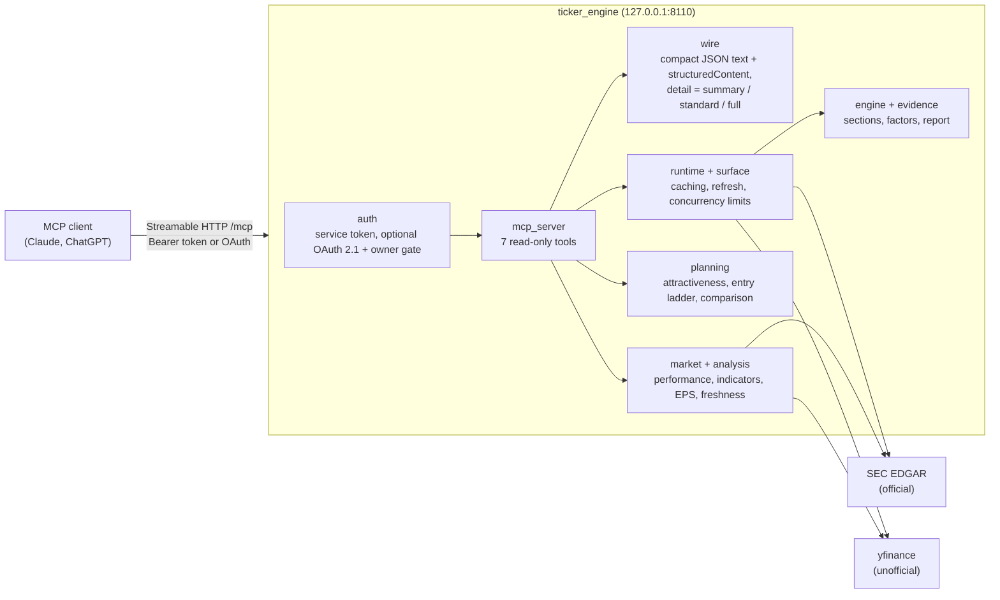

# Ticker Research

[한국어](README.ko.md)

Ticker Research is a read-only [MCP](https://modelcontextprotocol.io) server for researching one stock at a time
from an AI chat client such as Claude or ChatGPT. It is for individual investors who want issuer filings, daily
price history and a few transparent calculations in the chat, with every number labelled with its source and date.

It covers US tickers fully, and KRX listings (for example `005930`) for prices, indicators and entry scenarios
only. It uses two free data sources:

- **SEC EDGAR** (official): companyfacts financials, Form 4 insider filings and 10-K diluted EPS. SEC requires a
  descriptive `User-Agent` with a contact address, which you set in `SEC_USER_AGENT`.
- **Yahoo Finance via [yfinance](https://github.com/ranaroussi/yfinance)** (unofficial): daily bars, the latest
  trade, key metrics and analyst EPS consensus. yfinance is not an official Yahoo API. It can break or be rate
  limited, and every value from it is labelled `yfinance` / "unofficial" in the output.

The server holds no brokerage connection. It does not log in to any site, and it holds no account data.

## Tools

| Tool | What it returns |
|---|---|
| `get_ticker_research` | Issuer snapshot for one US ticker. It has SEC financials and insider filings, yfinance metrics and daily bars, and about 40 factors computed from the bars (RSI, MACD, ATR, moving averages, support/resistance levels, drawdown and risk scores). Each section carries `as_of`, `as_of_basis` and `source`. |
| `get_ticker_research_status` | Configuration state: SEC User-Agent present, technical factors on or off, auth mode, latest-price source health. |
| `plan_entry` | A scaled entry calculation for an amount you give: an attractiveness score with its components, tranche prices from the computed levels, and touch probabilities. It is a calculation, not an order. |
| `compare_tickers` | The same inputs for 2+ tickers: a ranking and allocation scenarios for an optional total amount. |
| `compare_price_performance` | Daily price performance of 1–8 US or Korean stocks, ETFs or indices on one common calendar. Metrics: normalized price, return %, relative strength against a benchmark, or excess return. It can convert between USD and KRW. |
| `get_technical_indicators` | RSI, MACD, Bollinger bands, SMA/EMA/RMA, ATR and others for one symbol, with warm-up history fetched before the window. |
| `get_eps_scenarios` | GAAP diluted EPS per fiscal year (SEC 10-K), P/E at each fiscal year end, and consensus EPS low/avg/high (yfinance). It gives bear/base/bull implied prices as EPS × P/E multiple. US SEC filers only. |

Missing data is reported as `unavailable` with a reason code, never as zero. A section whose source is not
configured (for example SEC without `SEC_USER_AGENT`) reports `provider_not_configured`. By default the latest
trade (including pre-market) appears as a value marked provisional. `confirmed_only=true` restricts every price
tool to completed daily closes.

## Architecture



Provider adapters live in `ticker_engine/providers/` and are the only modules allowed to make HTTP requests
(enforced by `tests/ticker_engine/test_isolation.py`). Engine and planning code is pure and works on the
adapters' normalized rows. Every computed value keeps its inputs, formula id and source in `full` detail.

## Response size budgets

Every tool returns `structuredContent` and the same object as compact JSON in a text block (MCP 2025-06-18). A
client that shows the model only the text therefore sees the same fields as one that reads
`structuredContent`.

| Tool | Budget |
|---|---|
| `get_ticker_research`, `plan_entry`, `compare_tickers` | `detail=standard` (default) keeps the last 20 daily bars, the latest 4 quarters and 3 rows of other collections, with rounded numbers and provenance stated once per section. `summary` keeps headline values only. `full` keeps every field and grows with history (see below). |
| `compare_price_performance`, `get_technical_indicators`, `get_eps_scenarios` | `structuredContent` ≤ 92,000 bytes, the whole response < 100 KB, the summary line < 2,000 characters. Over 260 points per series switches to weekly points. If the result is still over budget, the tool returns `RESPONSE_TOO_LARGE` rather than truncating silently. |

Measured on the offline test fixtures (one year of daily bars, text block bytes):

| Tool | summary | standard | full |
|---|---:|---:|---:|
| `get_ticker_research` | 7.8 KB | 11.5 KB | 2.08 MB |
| `plan_entry` | 3.4 KB | 6.3 KB | 66.6 KB |
| `compare_tickers` (2 tickers) | 5.1 KB | 6.1 KB | 181 KB |

`full` includes per-value provenance for every bar and the markdown report. Use it only for debugging or export.

## Cross-client regression

The same server is used from Claude (claude.ai shows the model only `content[].text`) and ChatGPT (reads
`structuredContent`). The test suite checks both paths offline through the real FastMCP dispatcher, with no
network calls:

- `test_wire_mcp.py` checks that the text block of the three dict tools is the same JSON as
  `structuredContent` at each detail level. It also checks that whole-call failures return `isError:true` and
  partial results do not.
- `test_market_mcp.py`, `test_market_tools.py` and `test_market_eps.py` check that each analysis tool's summary
  holds the headline numbers, the source line and (for EPS) the bear/base/bull rows, which is what a text-only
  client relies on. They also check the size limits above.
- `test_freshness.py` checks that all price tools agree on the confirmed close and the provisional latest
  trade.

No graded live run across clients has been recorded for this project, so there are no pass/partial/fail numbers
to report. The companion project [K-invest](https://github.com/ianlyoo/K-invest) publishes such numbers for its own
tools.

## Read-only safety

- Every tool is annotated `readOnlyHint: true, destructiveHint: false`. There are no order, transfer or account
  tools, and no brokerage credentials are read.
- The only state the server writes is its own cache in memory and, when OAuth is enabled, its OAuth client
  and grant store (SQLite in `TICKER_RESEARCH_OAUTH_STATE_DIR`). It writes nothing else unless you run an
  admin command yourself (`python -m ticker_engine.auth.oauth_admin`, root only).
- The service token is read from a file and kept only as a SHA-256 digest. It is never logged or echoed.
- Requests are accepted only from a direct `127.0.0.1` peer. A request with proxy headers counts as remote and
  needs OAuth.
- `plan_entry` and `compare_tickers` outputs are scenarios computed from public data. They are not investment
  advice.

## Quick start

Requires Python 3.11+.

```bash
git clone <this repository> ticker-research && cd ticker-research
python -m venv .venv && . .venv/bin/activate
pip install -e '.[dev]'
pytest tests/ -q                      # offline; no network or credentials needed

# Service token (32-256 chars of A-Z a-z 0-9 _ -), file mode 0600
mkdir -p ~/.config/ticker-research/credentials && chmod 700 ~/.config/ticker-research/credentials
python -c 'import secrets; print(secrets.token_urlsafe(32))' > ~/.config/ticker-research/credentials/ticker-service-token
chmod 600 ~/.config/ticker-research/credentials/ticker-service-token

export CREDENTIALS_DIRECTORY=~/.config/ticker-research/credentials
export SEC_USER_AGENT="Your Name your.address@your-domain.tld"   # SEC fair-access policy; placeholder domains are rejected
ticker-research                       # serves http://127.0.0.1:8110/mcp
```

Point an MCP client that supports Streamable HTTP at `http://127.0.0.1:8110/mcp` with the header
`Authorization: Bearer <contents of ticker-service-token>`. Then call `get_ticker_research_status` to check the
setup.

Optional settings:

| Variable | Effect |
|---|---|
| `TICKER_TECHNICAL_ENABLED` | `true` (default) or `false`; turns off the bar-derived factors. |
| `TICKER_RESEARCH_PUBLIC_URL`, `TICKER_RESEARCH_OAUTH_REDIRECT_URIS`, `TICKER_RESEARCH_OAUTH_STATE_DIR`, `OWNER_GATE_REDIRECT_ORIGINS` | Enable OAuth 2.1 with dynamic client registration and an owner passphrase consent page. Use this when you put the server behind your own HTTPS reverse proxy for a hosted client. The passphrase hash is created with `python -m ticker_engine.auth.owner_gate hash` and read from `CREDENTIALS_DIRECTORY`. See `ticker_engine/auth/` for the credential file names. |

## Project layout

```
ticker_engine/
  mcp_server.py   tool definitions and the ASGI app
  wire.py         compact JSON text block and detail levels
  runtime.py      provider composition, caching and refresh
  engine.py       snapshot sections and factor calculation
  evidence/       factor definitions and derived risk scores
  planning/       attractiveness, entry ladder, comparison (see planning/README.md)
  market/         performance, indicators, EPS scenarios, freshness
  analysis/       indicator math, checked against TA-Lib reference values
  providers/      SEC EDGAR and yfinance adapters
  auth/           service token, OAuth 2.1, owner gate
tests/            offline tests and synthetic or recorded public-data fixtures
```

## License and support

MIT, see [LICENSE](LICENSE).

This is a personal project published as-is. No support, maintenance or response to issues is promised. Data from
yfinance is unofficial and may be wrong, delayed or unavailable. Nothing this software outputs is investment
advice.
